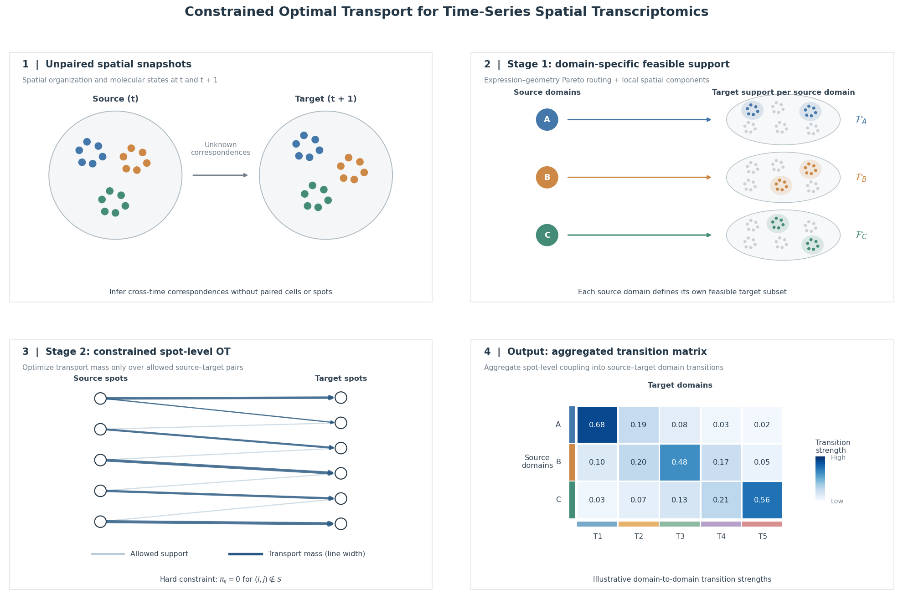
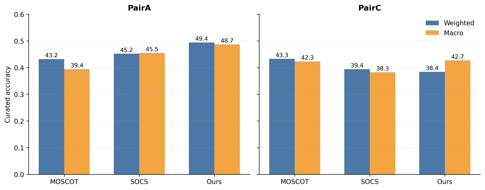
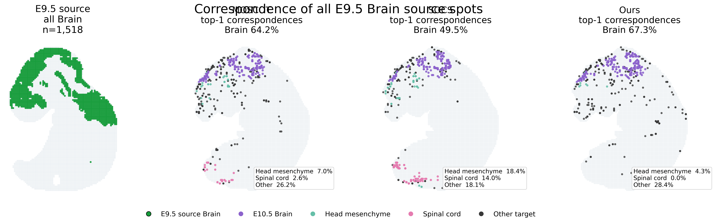
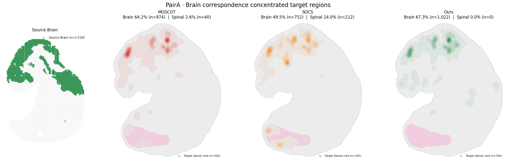

# Two-Stage Optimal Transport for Time-Series Spatial Transcriptomics

**Learning biologically plausible correspondences across unpaired spatial transcriptomics snapshots.**

Spatial transcriptomics captures cell states at individual time points, but does not directly tell us how cells or tissue regions correspond across stages. This project explores a **two-stage optimal transport (OT)** strategy: first identify plausible cross-time candidate matches using spatial organization and molecular information, then estimate spot-level transport within the resulting feasible set.

The repository contains the method implementation, **MOSCOT** and **SOCS** baseline pipelines, and experiments examining the strengths and limitations of inferred correspondences.

> **Scope.** This is an exploratory study of constrained correspondence inference and its diagnostics—not a claim of state-of-the-art performance. In particular, the two-stage approach does **not** consistently outperform the baselines in overall accuracy.

**Explore:** [Method](#method) · [Results](#results) · [Reproducibility](#reproducibility) · [Repository guide](#repository-guide) · [Limitations](#limitations)

## Method



*Conceptual illustration of the pipeline; the figure is schematic rather than an experimental result.*

### Stage 1 — Construct the feasible transport support

For each source region, Stage 1 identifies candidate target regions **without using cell-type annotation labels**:

1. **Spatial alignment:** align tissue contours and orientation, with bidirectional thin-plate spline (TPS) warping.
2. **Domain identification:** perform independent Leiden clustering on the source and target NBVAE-30 embeddings.
3. **Pareto candidate routing:** compare source and target domains using expression-centroid distance and spatial geometry distance as two separate objectives, rather than combining them into a fixed weighted sum.
4. **Support construction:** decompose selected target domains into spatially connected components, retain components reached by nearest-neighbor seeds, and assemble a spot-level feasible support.

The output is a binary support specifying which source–target spot pairs can receive transport mass.

### Stage 2 — Refine spot-level correspondences

Within the Stage 1 support, Stage 2 solves an **exact-hard constrained, unbalanced fused Gromov–Wasserstein (FGW)** problem. The implementation combines expression distances in NBVAE-30 space with spatial structural information, while enforcing zero transport mass outside the feasible support.

The Stage 2 implementation uses a sparse log-Sinkhorn routine and GW linearization adapted from OTT. See [the source code](src/stage2/constrained_ot.py) and [the reference notebook](notebooks/01_stage1_stage2.ipynb) for implementation details.

## Experimental setting

The method is evaluated using two consecutive-stage pairs from the **MOSTA mouse embryo spatial transcriptomics dataset**. MOSTA serves as a test dataset for the general problem of unpaired cross-time correspondence inference.

| Pair | Source section | Target section |
|:--|:--|:--|
| **Pair A** | E9.5_E1S1 | E10.5_E2S1 |
| **Pair C** | E10.5_E2S1 | E11.5_E1S1 |

The experiments use 30-dimensional NBVAE representations (`X_nbvae_30`). Cell-type annotations and curated developmental transitions serve as **evaluation references**, not as inputs to Stage 1 candidate construction.

## Results

### Overall curated-transition accuracy

The table summarizes selected runs from the saved results. The reported weighted and macro scores use the curated-transition evaluation; detailed configurations and original precision are available in [`results/baseline_summary.csv`](results/baseline_summary.csv).

| Pair | Method | Weighted | Macro |
|:--|:--|--:|--:|
| Pair A | **Two-stage OT** | **0.494** | **0.487** |
| Pair A | SOCS | 0.452 | 0.455 |
| Pair A | MOSCOT | 0.432 | 0.394 |
| Pair C | MOSCOT | **0.433** | 0.423 |
| Pair C | SOCS | 0.394 | 0.383 |
| Pair C | Two-stage OT | 0.384 | **0.428** |



**What these results suggest**

- **Pair A:** the selected two-stage run has the highest reported weighted accuracy among the listed runs.
- **Pair C:** two-stage OT has lower weighted accuracy than MOSCOT (0.384 vs. 0.433), although its reported macro score is slightly higher.
- **Across organs:** some spatially concentrated regions show strong organ-level correspondence, while diffuse or heterogeneous tissues remain challenging. High annotation accuracy does not necessarily imply a well-distributed or biologically reliable coupling.

**Interpretation caveat:** baseline runs were selected by weighted accuracy against the curated reference; these are *not* held-out estimates of generalization. The two-stage entries are taken from their saved mass-aggregated summaries. Historical configuration and metric differences should be checked before treating this table as a strictly controlled head-to-head benchmark.

### Spatial and organ-level diagnostics

The diagnostic notebooks examine where transport mass goes, how the feasible support affects candidate matches, and when seemingly high annotation accuracy masks problematic concentration of mass.

<details>
<summary><strong>Example: Pair A Brain correspondence across methods</strong></summary>



</details>

<details>
<summary><strong>Example: Pair A failure-case and spatial concentration analysis</strong></summary>



</details>

For the analyses behind these figures, see [spatial correspondences](notebooks/02_spatial_correspondence.ipynb), [cell-type evaluation](notebooks/03_cell_type_evaluation.ipynb), [failure diagnostics](notebooks/04_failure_diagnostics.ipynb), and [feasible-set visualization](notebooks/05_stage1_feasible_set_viz.ipynb).

## Reproducibility

This repository publishes source code, configurations, reference notebooks, and small result tables. **It is not yet a fully verified, end-to-end reproduction package.**

| Component | Current status |
|:--|:--|
| Stage 1 / Stage 2 source modules | Available; extracted from experiment notebooks |
| Source-level equivalence | Checked against notebook implementations; see [EQUIVALENCE.md](EQUIVALENCE.md) |
| Saved results and figures | Available as CSV, JSON, and PNG |
| Raw / processed H5AD and large transport arrays | Not included |
| End-to-end numerical reproduction from fresh inputs | **Not yet verified** |

### Data and dependencies

- **Data:** see [data/README.md](data/README.md) for section IDs, input schema, and data provenance.
- **Environment:** see [environment.yml](environment.yml). The original Stage 2 configuration requires a JAX GPU backend; SOCS used a separate environment.
- **Notebooks:** retained as historical reference implementations and may contain original absolute paths. Paths must be adapted before execution.

### Baseline implementations

| Baseline | Actual entry points | Notes |
|:--|:--|:--|
| **MOSCOT** | [grid generator](baselines/moscot/09_make_nbvae30_fgw_grid.py) → [grid runner](baselines/moscot/06_run_fgw_local.py) → [per-task solver](baselines/moscot/05_run_fgw_grid_point.py) | Full-rank FGW, NBVAE-30; [configuration details](baselines/moscot/README.md) |
| **SOCS** | [official-implementation caller](baselines/socs/run_official.py), [Pair C resume entry](baselines/socs/resume_pairc.py) | Depends on the external SOCS source; [configuration details](baselines/socs/README.md) |

No new or unverified one-command wrappers are presented as original experimental entry points.

**Parameter conventions:** for MOSCOT, `alpha` is the GW (quadratic) weight, whereas for SOCS it is the expression weight; the caller maps `alpha_socs = 1 - alpha_moscot`. The experiments use `epsilon = 1e-4` and a grid of `alpha_moscot ∈ {0.2, 0.4, 0.6}` and `(tau_a, tau_b) ∈ {(1, .01), (1, .05), (.05, 1), (.01, 1)}`, without growth marginals. For precise per-method settings and actual invocation requirements, follow the baseline READMEs rather than assuming the two solvers share identical parameter semantics.

## Repository guide

```text
configs/             Pair-specific grids, evaluation references, run configs
src/
  stage1/            Alignment, clustering, Pareto routing, feasible support
  stage2/            Constrained unbalanced FGW implementation
  evaluation/        Accuracy and support diagnostics
baselines/
  moscot/            MOSCOT experiment drivers and documentation
  socs/              SOCS experiment callers and documentation
notebooks/           Original analysis and diagnostic workflows
results/             Selected metrics, support summaries, organ-level tables
figures/             Method illustration and representative diagnostics
data/                Data provenance and required input structure
EQUIVALENCE.md       Source-extraction audit and verification limits
environment.yml      Recorded software environment
```

## Limitations

- **Transport concentration:** on Pair C, Brain and dorsal root ganglion (DRG) couplings can concentrate mass on relatively few target spots despite high per-organ annotation accuracy. See the organ-level tables in [results/PairC](results/PairC/stage1_stage2/).
- **Parameter sensitivity:** candidate supports and downstream couplings depend on domain definitions and routing choices; the reported Leiden experiments use a single seed (`seed=0`).
- **Incomplete portability:** processed inputs are excluded and the historical notebooks contain absolute paths. A clean-environment numerical rerun remains outstanding.
- **Incomplete variants:** `src1_tgt1p4` appears only in Stage 1 investigations, not as a complete Stage 2 comparison.

## Attribution and license

This work builds on [MOSCOT](https://github.com/ComputationalCellBiology/moscot), [OTT-JAX](https://github.com/ott-jax/ott), and the external [SOCS implementation](https://github.com/algo-bio-lab/SOCS-main). The dependencies and their respective licenses remain governed by their original projects; see the [baseline documentation](baselines/) and [LICENSE](LICENSE).

**Provenance and AI assistance:** the method-overview figure is AI-generated and is intended only as a schematic. AI coding assistance was used in organizing or drafting parts of the code and documentation. The repository preserves the original experiment outputs; [EQUIVALENCE.md](EQUIVALENCE.md) states what has and has not been independently verified. Scientific interpretation and method decisions remain the author's responsibility.
